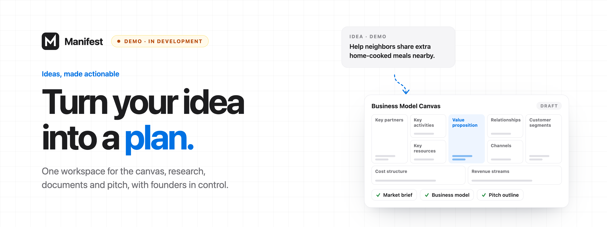
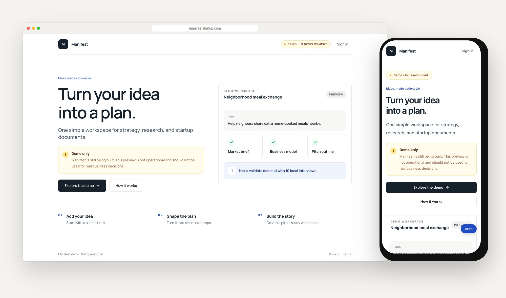
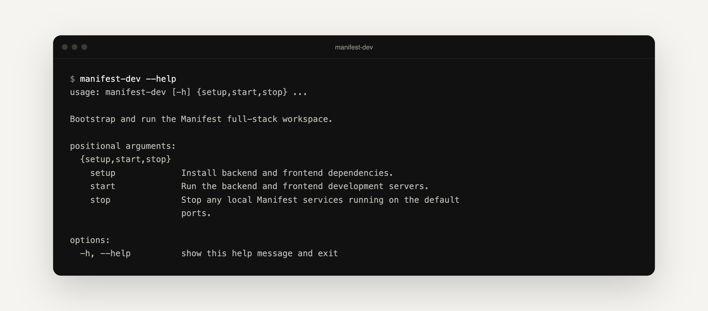

<p align="center">
  <a href="https://manifeststartup.com">
    <picture>
      <source media="(prefers-color-scheme: dark)" srcset=".github/assets/banner-dark.png">
      
    </picture>
  </a>
</p>

<p align="center">
  <strong>From a rough idea to an investable plan, in one workspace.</strong><br>
  Write your idea as a note. Manifest turns it into a business model canvas, research and startup documents, and keeps them in step as the idea changes.
</p>

<p align="center">
  <a href="https://manifeststartup.com"><strong>Website</strong></a> ·
  <a href="docs/QUICKSTART.md"><strong>Quick start</strong></a> ·
  <a href="docs/README.md"><strong>Docs</strong></a> ·
  <a href="mcp_server/README.md"><strong>MCP server</strong></a> ·
  <a href="docs/PRODUCT_VISION.md"><strong>Vision</strong></a>
</p>

<p align="center">
  <a href="LICENSE"></a>
  
  
</p>

<p align="center">
  <picture>
    <source media="(prefers-color-scheme: dark)" srcset=".github/assets/hero-dark.jpg">
    
  </picture>
</p>

## Why Manifest

Most ideas die between the note and the first real step. Founders juggle a canvas in one tool, research in another, a pitch deck in a third, and legal and HR templates somewhere else. Nothing stays in sync, and money often goes on incorporation before anyone has checked whether the idea holds up.

**Manifest is an IDE for startups.** You capture the idea once. AI turns it into linked, structured work (canvas, research, documents and a pitch) that updates when the idea changes. Teammates and investors can join the same workspace, and you decide what gets published.

<table>
  <tr>
    <td width="33%" valign="top">
      <h3>01 · Idea in, plan out</h3>
      A short note becomes a Business Model Canvas, related ideas to learn from, and drafts of pitch decks and other startup documents.
    </td>
    <td width="33%" valign="top">
      <h3>02 · Everything stays linked</h3>
      Edit the idea and the artifacts built from it follow. Every aspect of an idea lives in one workspace you can share with teammates.
    </td>
    <td width="33%" valign="top">
      <h3>03 · Founders stay in control</h3>
      AI drafts, you decide. Ideas stay private until you publish them, and only published ideas can be messaged about by others.
    </td>
  </tr>
</table>

> **Capture the spark. Develop the case. Operate with confidence.**

## What is in the workspace

| Feature | Where |
| --- | --- |
| **Idea workspace**: capture ideas, iterate on each aspect, invite teammates | `/ideas` |
| **AI artifacts**: Business Model Canvas, pitch decks and patent, HR and legal-oriented drafts, with optional web research | `/ideas/:id/:aspect` |
| **Similar ideas**: related concepts and references surfaced early | Idea workspace |
| **Pitch Reels**: a short-form feed of pitch clips for published ideas, with optional AI video when configured | `/pitch-reels` |
| **Messages**: direct conversations; messaging about an idea requires it to be published | `/messages` |
| **Follow and invest flows** for full accounts; guests are kept out of sensitive actions | GraphQL |
| **Manifest Voice**: hands-free navigation and commands when signed in | Everywhere |
| **Guest sessions**: explore the workspace before creating an account | Landing page |
| **MCP server**: connect Claude and other AI clients to a Manifest backend | [`mcp_server/`](mcp_server/README.md) |

On iPhone, an iOS-style layout is chosen automatically (or with `?view=ios`), mirroring the same routes.

## Quick start

**You need:** Python 3.11+, Node.js and npm. No database is required to try it: without Supabase credentials the backend runs in a demo mode with in-memory storage.

```bash
git clone https://github.com/Manifest-Startup/Manifest.git
cd Manifest
python3 -m pip install -e .   # installs the manifest-dev CLI
manifest-dev setup            # backend and frontend dependencies
manifest-dev start            # backend :8000, frontend :3000
```

<p align="center">
  
</p>

Open <http://localhost:3000>. The backend is at <http://localhost:8000> and GraphQL at <http://localhost:8000/graphql>. In demo mode, sign in with the bundled demo account in [`docs/QUICKSTART.md`](docs/QUICKSTART.md), or set `DEMO_MODE=1` to force it. You can also open the repo in VS Code or Cursor and choose **Reopen in Container**.

<details>
<summary><strong>Environment variables</strong></summary>
<br>

Create a `.env` file in the project root (see `.env.example`). Common entries:

```env
SUPABASE_URL=your_supabase_url
SUPABASE_SERVICE_ROLE_KEY=your_supabase_service_role_key
OPENAI_API_KEY=your_openai_api_key            # optional local-dev fallback; users normally add their own key in Account settings
AI_MODEL=gpt-4o-mini
VOICE_AGENT_MODEL=gpt-4o-mini
VOICE_AGENT_TTS_MODEL=tts-1
VOICE_AGENT_TTS_VOICE=nova
VOICE_REALTIME_ENABLED=false                          # near-instant speech-to-speech (WebRTC); costs more than tts-1
VOICE_REALTIME_MODEL=gpt-4o-realtime-preview          # realtime voices differ from TTS (no `nova`)
VOICE_REALTIME_VOICE=shimmer
VOICE_REALTIME_ALLOW_GUESTS=false                     # guests are blocked from realtime by default (cost)
MANIFEST_AGENT_LOOP_SECRET=shared_internal_secret     # optional; internal agent-loop routes
MANIFEST_GITHUB_REPO=Manifest-Startup/Manifest        # optional; internal feedback issue sync
MANIFEST_GITHUB_TOKEN=your_github_token               # optional
POSTHOG_API_KEY=your_posthog_api_key                  # optional; analytics
SESSION_SECRET=replace_this_with_a_long_random_secret_for_non_demo_auth
GOOGLE_API_KEY=                                       # optional; Pitch Reel video (Gemini)
```

Frontend analytics keys (when used): `REACT_APP_PUBLIC_POSTHOG_KEY`, `REACT_APP_PUBLIC_POSTHOG_HOST`. GraphQL URL override: `REACT_APP_GRAPHQL_URL` (default `/graphql`).

**Surveys** (`/research` for visitors, `/feedback/survey` when signed in) store responses in Postgres (`survey_responses`); apply the migrations in `supabase/migrations/`. See [`docs/customer-research-surveys.md`](docs/customer-research-surveys.md).

</details>

<details>
<summary><strong>Connect an AI client with the MCP server</strong></summary>
<br>

The MCP package lives in [`mcp_server/`](mcp_server/README.md). It is not published on PyPI yet, so install it from this repository and point it at a running backend (the default is `http://localhost:8000`):

```bash
python3 -m pip install ./mcp_server
export MANIFEST_API_URL="http://localhost:8000"
export MANIFEST_API_TOKEN="your-api-token"
manifest-mcp
```

Client configuration examples are in [`mcp_server/README.md`](mcp_server/README.md).

</details>

## How it works

```text
React + Vite SPA (desktop and iOS layouts)
        │  Apollo GraphQL · Socket.IO
        ▼
FastAPI + Strawberry GraphQL ──► ManifestManager orchestrator ──► OpenAI (artifacts, research, voice)
        │                                                     └─► Google GenAI (optional Pitch Reel video)
        ▼
Supabase / PostgreSQL  (or in-memory demo mode)
```

| Layer | Technologies |
| --- | --- |
| Frontend | React 18, TypeScript, Vite, Tailwind CSS, Apollo Client, Redux Toolkit, Socket.IO client |
| Backend | Python 3.11+, FastAPI, Strawberry GraphQL, Socket.IO |
| Data | Supabase / PostgreSQL, with an in-memory demo mode |
| AI | OpenAI API with bring-your-own-key (each user adds their own key); optional Google GenAI for reel video |
| Analytics | PostHog (optional) |

<details>
<summary><strong>Repository layout and app routes</strong></summary>
<br>

```text
├── backend/           # FastAPI + Strawberry GraphQL API
│   └── app/
│       ├── routes/ graphql/ middleware/   # API layer: HTTP in, call a service
│       ├── services/<domain>/             # business logic: ai, canvas, documents, ideas,
│       │                                  #   pitch_reels, social, voice, identity, compliance, …
│       ├── auth/ security/                # sign-in, sessions, cookies, permissions
│       ├── db/                            # Postgres / Supabase access
│       └── utils/ prompts/ assets/        # logger, prompt files, bundled assets
├── frontend/          # React + Vite app, one folder per feature in src/features/
├── deploy/cloudflare/ # Edge Worker: serves the app, proxies the API
├── mcp_server/        # Installable MCP server for AI tools
├── ios/               # Native SwiftUI prototype
├── supabase/          # Database migrations
├── scripts/           # check.py (local checks), codegraph/ (code map), setup helpers
├── tests/             # tooling, load and production smoke tests
├── src/manifest_dev/  # manifest-dev CLI (pip install -e .)
└── docs/              # Guides, API, security and legal templates
```

| Area | Path | Notes |
| --- | --- | --- |
| Landing | `/` | Marketing and demo entry |
| About | `/learn-more` | How Manifest works |
| Ideas | `/ideas`, `/ideas/:id/:aspect` | Signed-in workspace |
| Pitch Reels | `/pitch-reels` | Immersive feed (`/shorts` and `/discover` redirect here) |
| Messages | `/messages` | Inbox and threads |
| Account | `/account`, `/account/billing` | Profile, settings and billing (`/portfolio` redirects here) |
| Auth | `/auth`, `/auth/forgot-password`, `/auth/reset-password` | Email sign-in |
| Surveys | `/research`, `/feedback/survey` | Visitor and signed-in feedback |
| Docs | `/docs`, `/docs/guide`, `/docs/api` | In-app documentation |
| Legal | `/legal/terms`, `/legal/privacy` | Terms and privacy |

Architecture notes: [`docs/ARCHITECTURE_REFERENCE.md`](docs/ARCHITECTURE_REFERENCE.md) and [`AGENTS.md`](AGENTS.md). Leaving Replit: [`docs/MIGRATION_FROM_REPLIT.md`](docs/MIGRATION_FROM_REPLIT.md) and [`docs/LOCAL_DEV_WITHOUT_REPLIT.md`](docs/LOCAL_DEV_WITHOUT_REPLIT.md).

</details>

<details>
<summary><strong>Internal quality loops</strong></summary>
<br>

Operations automation, not end-user features:

- **Website audit loop**: [`docs/WEBSITE_ISSUE_SYNC.md`](docs/WEBSITE_ISSUE_SYNC.md)
- **Survey feedback loop**: [`docs/SURVEY_FEEDBACK_OPS.md`](docs/SURVEY_FEEDBACK_OPS.md)
- **Autopilot**: an hourly loop that implements one issue per run and opens pull requests into the protected `autopilot` branch, never `main`. A human promotes changes to `main`. See [`docs/AUTOPILOT.md`](docs/AUTOPILOT.md).

</details>

## Honest status

Manifest is **in development**. The public site at [manifeststartup.com](https://manifeststartup.com) is labelled a demo and says plainly that it is not operational and should not be used for real business decisions.

- AI-generated canvases, research and documents are drafts. Legal, patent and HR outputs are not legal advice and need professional review.
- Pitch Reel video generation only runs when a Google GenAI key is configured.
- Follow, invest and funding flows are product features in the app, not a regulated investment platform. Billing and equity mechanics must match live billing code before they are offered.
- The MCP package is installed from this repository; it is not on PyPI yet.
- AI features run on each user's own OpenAI API key (Account → AI settings). Manifest does not pay for or proxy anyone's AI usage.
- Manifest is open source under the MIT license. This public repository started from a cleaned snapshot on 2026-11-14; earlier private history (which held customer data and company records) is not published.

## Documentation

| Document | What it covers |
| --- | --- |
| [Docs hub](docs/README.md) | Every maintained guide |
| [Quick start](docs/QUICKSTART.md) | Local setup in detail |
| [API](docs/API.md) | The backend API |
| [Voice agent API](docs/VOICE_AGENT_API.md) | Manifest Voice |
| [Product vision](docs/PRODUCT_VISION.md) | What Manifest is for and how it is built |
| [Founding memo](docs/FOUNDING_MEMO.md) | Edited founding notes |

## Contributing

Contributions are welcome. Start with [`CONTRIBUTING.md`](CONTRIBUTING.md): it covers setup, the one local check command (`python3 scripts/check.py`) and how pull requests are reviewed. Everyone taking part follows the [Code of Conduct](CODE_OF_CONDUCT.md). Report security problems privately as described in [`SECURITY.md`](SECURITY.md), never in a public issue.

## License

[MIT](LICENSE) © Manifest Startup

<p align="center">
  <br>
  <sub><strong>Manifest</strong> · Ideas, made actionable.</sub>
</p>
