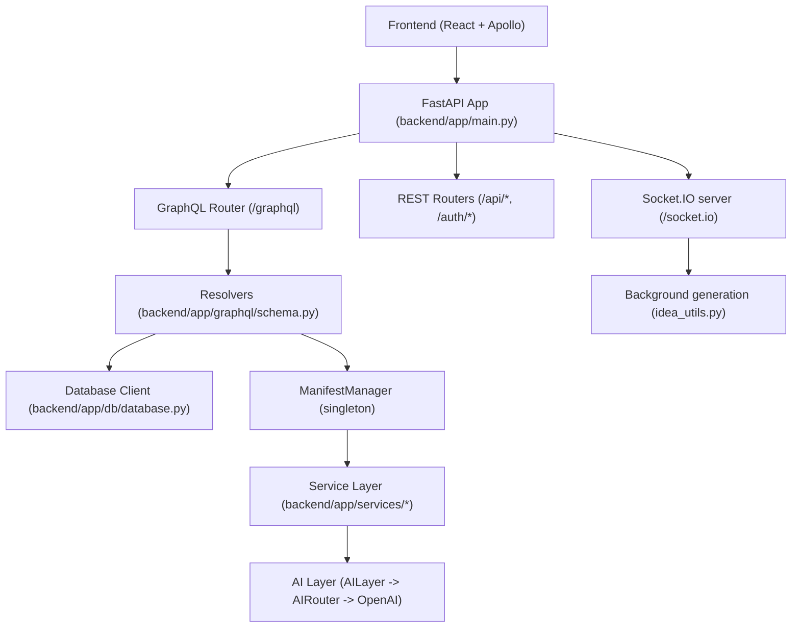

# Architecture Reference

Last verified against code on **May 3, 2026**.

## Runtime Topology



## Backend Architecture

### 1) Application bootstrap (`backend/app/main.py`)

Responsibilities:

- Load environment from project root `.env`
- Configure CORS and visitor tracking middleware
- Instantiate singleton `manifest_manager`
- Register REST routers
- Mount Strawberry GraphQL router on `/graphql`
- Setup Socket.IO handlers
- Serve built frontend assets when `frontend/build` exists

### 2) API layer split

GraphQL:

- Contract and logic in `backend/app/graphql/schema.py`
- Covers auth, ideas, generation, integrations, social graph, investing, messaging, and collaboration

REST:

- `/api/v1/*` public API key-based interface
- `/api/internal/website-testing/*` internal agent feedback loop for website audit and GitHub issue sync
- `/api/internal/survey-ops/*` internal agent feedback loop for survey analytics and GitHub issue sync
- `/api/internal/production-signals/*` deduped production anomaly ingest and optional GitHub issue sync (`docs/PRODUCTION_SIGNALS_OPS.md`)
- `/api/keys/*` API key lifecycle management
- `/api/voice-agent/*` conversational idea qualification and TTS
- `/auth/*` Replit OAuth and session endpoints
- Shared auth dependency used by session-protected REST routes: `backend/app/routes/dependencies.py`

### 3) Orchestration and services

`ManifestManager` (`backend/app/managers/manifest_manager.py`) holds composed services and exposes high-level methods:

- `set_idea`
- `update`
- `generate_pitch_deck`
- `generate_product_requirements_document`
- `find_similar_ideas`
- document helpers for legal/ops/HR modules

Many service classes are thin wrappers around AI prompt execution and summary state.

### 4) AI execution path

- `AILayer` (`backend/app/services/ai/layer.py`) is used by services.
- `AIRouter` (`backend/app/services/ai/router.py`) handles API calls, retries, JSON-mode responses, and web search.
- Main provider wiring uses `OPENAI_API_KEY`.
- Website audit automation composes `AIRouter` with `httpx` crawling and GitHub Issues API writes in `backend/app/services/operations/website_issue_sync.py`.
- Survey feedback automation reads `survey_responses`, computes aggregate product signals, and reuses shared GitHub issue creation helpers in `backend/app/services/operations/survey_ops.py` and `backend/app/services/integrations/github_issues.py`.
- Optional GitHub **Projects v2** linkage lives in `backend/app/services/integrations/github_projects.py` and runs after successful issue creation when project env vars are set.

### 5) Background generation path

Triggered by GraphQL `runBackgroundTasks` or Socket event.

Flow:

1. Spawn thread (`backend/app/services/ideas/document_generation.py`)
2. Acquire `_manifest_manager_lock`
3. Set idea on singleton manager
4. Generate similar ideas, BMC, pitch deck, PRD, patent artifacts
5. Persist results to DB tables
6. Optionally emit Socket.IO events

## Data Access Layer

`backend/app/db/database.py` provides:

- `DatabaseClient` + `QueryBuilder` abstraction
- SQL-backed behavior when `DATABASE_URL` exists
- In-memory fallback client when DB is unavailable or `USE_IN_MEMORY_DB` is enabled

This allows local/demo execution without external DB, but state is non-persistent.

## Auth and Session Model

Primary token parsing logic: `backend/app/auth/current_user.py`.

Token accepted from:

- `session_token` cookie
- `access_token` cookie
- `Authorization` bearer header

Demo mode behavior:

- auto-enables when DB is not configured (unless explicitly disabled)
- default credentials: `hello@manifeststartup.com` / `manifest`

## Frontend Architecture

### 1) App shell and routing

- Entry: `frontend/src/index.tsx`
- Main routes: `frontend/src/App.tsx`
- iOS alternate shell: `frontend/src/features/ios/AppIOS.tsx`

### 2) Data/state strategy

- Apollo Client for transport and caching
- GraphQL operation catalog in `frontend/src/features/core/apollo/queries.ts`
- Local app state via Apollo reactive vars in `frontend/src/features/core/apollo/localState.ts`

### 3) Feature modules

- Ideas editor and document views
- Discover/social feed with voting/following
- Account page with integrations and API key management
- Account page also surfaces aggregate survey insights from GraphQL `surveyInsights`
- Messaging (on Open Media) + collaboration features
- Pitch Shorts (`/pitch-reels`): Manifest reels joined with Open Media clips
- Voice assistant UI + TTS fallback plus deterministic app-command routing (shared voice REST client: `frontend/src/features/voice/voiceAgentApi.ts`). The marketing home page can start a **guest session** and open the same overlay; guests hear an onboarding-oriented first turn when `onboarding_mode` is set on `/api/voice-agent/start`.

## Request Flow Examples

### Example: update idea description

1. Frontend editor updates local content.
2. Debounced mutation `updateIdea` sent to `/graphql`.
3. Resolver validates meaningful content.
4. DB row updated in `ideas` table.

### Example: generate documents

1. Frontend calls mutation `runBackgroundTasks`.
2. Resolver starts background thread and returns `true` immediately.
3. Background worker generates artifacts through manager/services.
4. Results are persisted and fetched by subsequent UI refetches.

### Example: voice command to workspace action

1. Frontend voice UI parses the transcript through the central voice command registry.
2. Deterministic commands dispatch to navigation, GraphQL mutations, or page-local UI events without calling the strategist endpoint.
3. The UI speaks the result and immediately returns to listening mode.

### Example: voice to saved idea

1. Frontend voice UI calls `/api/voice-agent/process` repeatedly.
2. User qualifies idea through the strategist path.
3. Frontend persists the synthesized note into the active idea via GraphQL.
4. Generated artifacts refresh through the existing backend document workflow.

### Example: website audit to GitHub issue

1. Internal agent or workflow calls `/api/internal/website-testing/sync-issues` or the MCP website audit tool.
2. Backend discovers public routes from `sitemap.xml` and homepage links.
3. `operations/website_issue_sync.py` crawls bounded pages, generates issue candidates, and de-duplicates them against open GitHub issues.
4. Backend creates GitHub issues directly when repository credentials are configured.

### Example: survey response to GitHub issue

1. Visitor or signed-in user submits `/research` or `/feedback/survey`.
2. GraphQL `submitSurvey` stores the response in `survey_responses`.
3. `operations/survey_ops.py` aggregates marketability / PMF signals and clusters repeated open-text themes.
4. Internal REST routes, MCP tools, or `.github/workflows/survey-feedback.yml` can turn repeated themes into GitHub issues.

## Architectural Risks to Keep in Mind

- Singleton manager + threaded generation means state isolation must be carefully preserved.
- `/api/v1/ideas/{idea_id}/generate` performs generation synchronously and can become a latency hotspot under load.
- Website issue sync depends on external network access and repo credentials; configure dry-run mode for safe validation.
- Survey feedback automation depends on production survey data in Postgres; dry-run mode is useful when validating thresholds or labels.
- Some older modules/patterns remain alongside newer ones (for example, refactored manager prototype not active).
- Docs and API examples should be validated against live schema/routes before release.

## Systems engineering and scaling docs

- [docs/OBSERVABILITY_AND_SLO.md](OBSERVABILITY_AND_SLO.md) — SLOs, GraphQL performance headers, DB pool snapshot, LLM metrics guidance.
- [docs/MEDIA_OBJECT_STORAGE_MIGRATION.md](MEDIA_OBJECT_STORAGE_MIGRATION.md) — plan to move `generated/` binaries to object storage.
- [docs/ASYNC_JOB_QUEUE_DESIGN.md](ASYNC_JOB_QUEUE_DESIGN.md) — target async job model for generation and REST `/api/v1` parity.
- [docs/SOCKETIO_HORIZONAL_SCALING.md](SOCKETIO_HORIZONAL_SCALING.md) — multi-replica Socket.IO with Redis.
- [docs/EDGE_SECURITY_AND_INTERNAL_ROUTES.md](EDGE_SECURITY_AND_INTERNAL_ROUTES.md) — WAF/rate limiting at edge and internal route inventory.

GraphQL types for some domains are split from the monolithic schema module (for example `backend/app/graphql/pitch_reel_types.py` and `backend/app/graphql/open_media_types.py`); see `backend/app/graphql/README.md`.

## Open Media (Messages and Pitch Shorts)

Decision record: [adr/0001-open-media-for-messages-and-pitch-shorts.md](adr/0001-open-media-for-messages-and-pitch-shorts.md). Contract: [OPEN_MEDIA_CONTRACT.md](OPEN_MEDIA_CONTRACT.md).

```
Browser ──GraphQL──> Manifest backend ──> services/integrations/open_media/  (the only Open Media caller)
   │                                              │ httpx: /token, /v1/connected/me/*, /v1/feed, /v1/posts
   │ Supabase Realtime (user's OM token, read-only)▼
   └──────────────────────────────────────> Open Media (api.openmedia.site)
Manifest backend <── POST /api/webhooks/open-media (HMAC, ids only) ──┘
```

- **Owns:** Open Media holds conversations, messages, read state, video files, clip posts, likes, comments and reshares. Manifest holds ideas, investing, Veo generation and pointers: the account link in `integrations` (`service_id = open_media`, encrypted refresh/access tokens + `om_user_id`, `handle`) and `pitch_reels.om_post_id`.
- **Adapter** `backend/app/services/integrations/open_media/`: `settings` (env), `store` (encrypted link), `client` (timeouts, retries, token refresh), `identity` (OAuth 2.1 + PKCE linking), `messaging`, `clips`, `webhooks`. Resolvers in `schema.py` and `pitch_reels/` call it; nothing else talks to Open Media.
- **Linking:** `GET /api/integrations/open-media/connect` → Open Media `/authorize` (client id = the CIMD URL `/oauth/open-media-client.json`, a static asset) → `GET /api/integrations/open-media/callback`.
- **Messages:** `myConversations` etc. resolve through the adapter (`app=manifest`, `context.idea_id`); "Message founder" uses the founder's linked handle. The browser subscribes to Open Media Realtime with `openMediaRealtimeToken` and polls every 5 minutes as fallback.
- **Pitch Shorts:** publish → Veo (only for linked founders, at most once per idea per 30 days) → upload as the founder → clip post with `context {app, idea_id, title, url}` → `om_post_id`. Unpublish deletes the post. `pitchReelsFeed` joins reels with the clips feed.
- **Webhooks** drop cached unread counts (5 min TTL) and clip stats (60 s TTL) in `app.services.shared.cache`.
- **Off switch:** without `OPEN_MEDIA_ENABLED`, Messages and Pitch Shorts are hidden; there is no built-in fallback.
