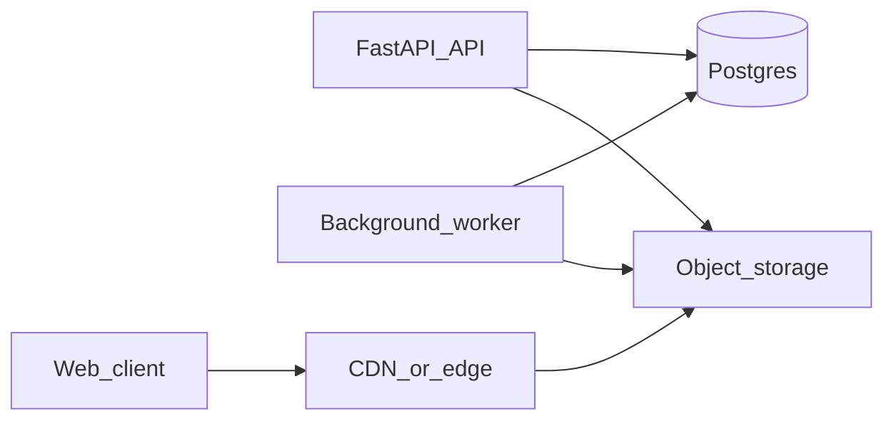

# Media and generated files: object storage migration plan

Last updated **May 3, 2026**.

Manifest currently writes some generated assets under `generated/` on the API host (for example pitch reel MP4s per [docs/API.md](API.md)). Ephemeral deploy targets lose local disk; CDN frontends cannot reliably serve those paths. This document is the **migration plan** toward durable object storage with cache-friendly URLs.

## Goals

1. **Durability** — survive deploys, horizontal scaling, and process restarts.
2. **Performance** — serve large binaries from a CDN or signed-URL edge where possible.
3. **Security** — prefer short-lived signed URLs for non-public content; public URLs only where the product requires it.
4. **Updatability** — stable URL contract for the frontend (`videoUrl`, PDF links) backed by storage keys in Postgres.

## Scope (artifacts to cover)

| Asset type | Typical path / source | Notes |
|------------|----------------------|--------|
| Pitch reel video | `generated/pdfs/pitch-reels/` | See `pitch_reels/video_worker.py`; production checklist in [docs/API.md](API.md). |
| Patents / PDFs | `generated/pdfs/` (and related helpers) | Audit `patent_pdf_utils` and download routes for current file naming. |
| Other generated documents | Same tree as applicable | Inventory during implementation. |

## Target architecture

- **Write path**: workers upload bytes to object storage, persist `storage_bucket`, `object_key`, `content_type`, `byte_size`, and optional `public_url` / `etag` on the owning row (e.g. `pitch_reels`).
- **Read path**: resolvers return either a **public** stable URL (if the object is public-read) or a **signed URL** generated on read (short TTL), depending on privacy requirements.

## Provider options

- **Supabase Storage** — aligns with existing Supabase usage; bucket policies and signed URLs are well documented.
- **S3-compatible** (AWS S3, R2, etc.) — portable; use presigned GET for private objects.

Pick one primary provider per environment to minimize operational surface area.

## Migration phases

1. **Dual-write (optional)** — continue writing local file while also uploading to storage; compare checksums in logs until confidence is high.
2. **Read preference** — API prefers storage URL when `object_key` is set, else legacy local path for backfill period.
3. **Backfill** — one-off job uploads existing rows that only have local paths.
4. **Remove local dependency** — delete local write paths in workers; ensure CI and local dev use a dev bucket or MinIO.

## Environment variables (proposed)

Document concrete names when implementing; placeholders:

- `MANIFEST_MEDIA_STORAGE_PROVIDER` — `supabase` | `s3`
- `MANIFEST_MEDIA_BUCKET` — bucket name
- Credentials via existing secret management (never commit keys).

## Testing

- Integration tests against a fake S3 (e.g. moto) or Supabase test project.
- Contract tests for GraphQL fields that expose media URLs.

## References

- [docs/API.md](API.md) — pitch reel production checklist.
- [docs/ARCHITECTURE_REFERENCE.md](ARCHITECTURE_REFERENCE.md) — background generation flow.
